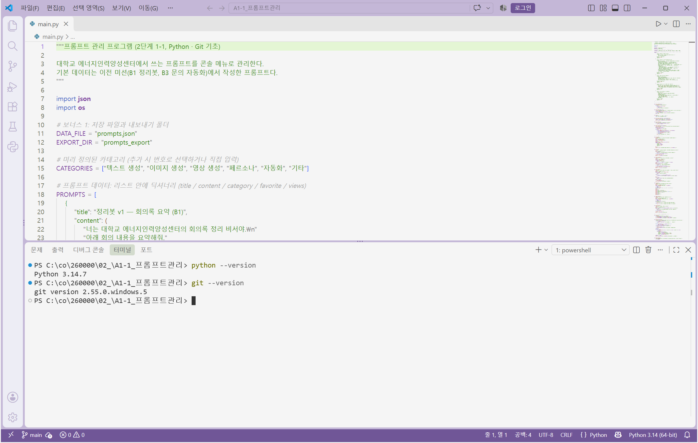
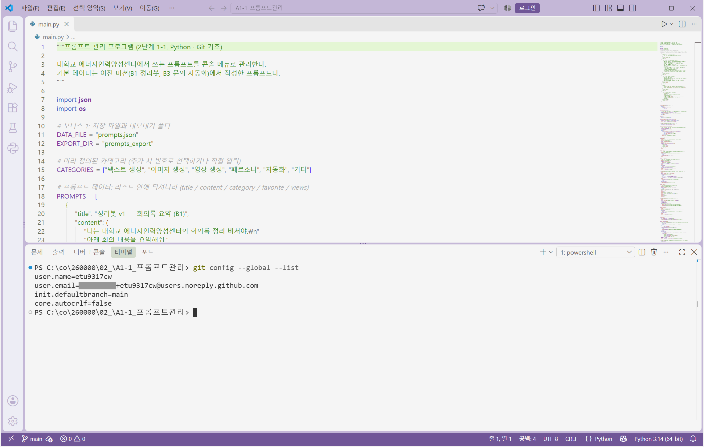
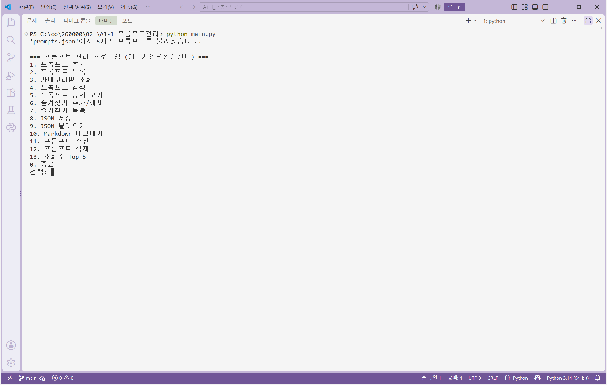
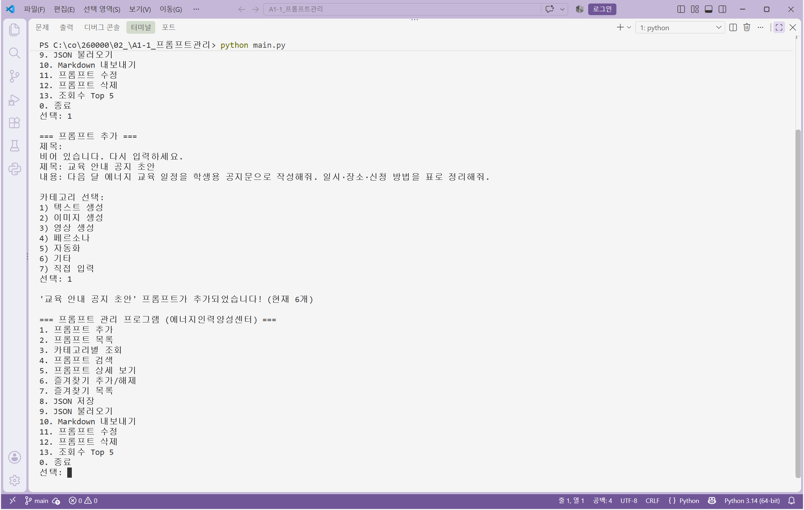
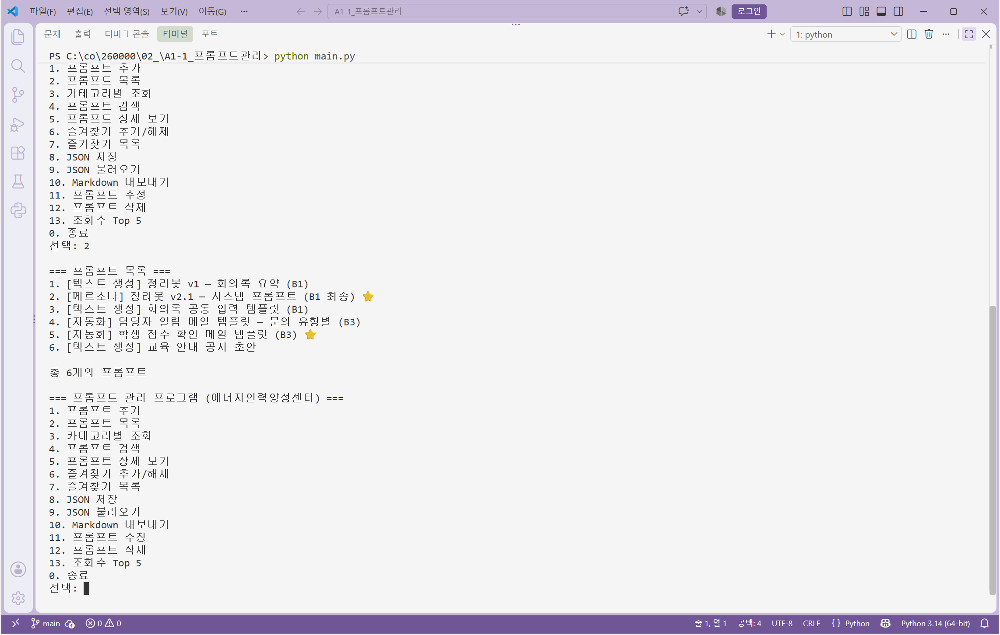
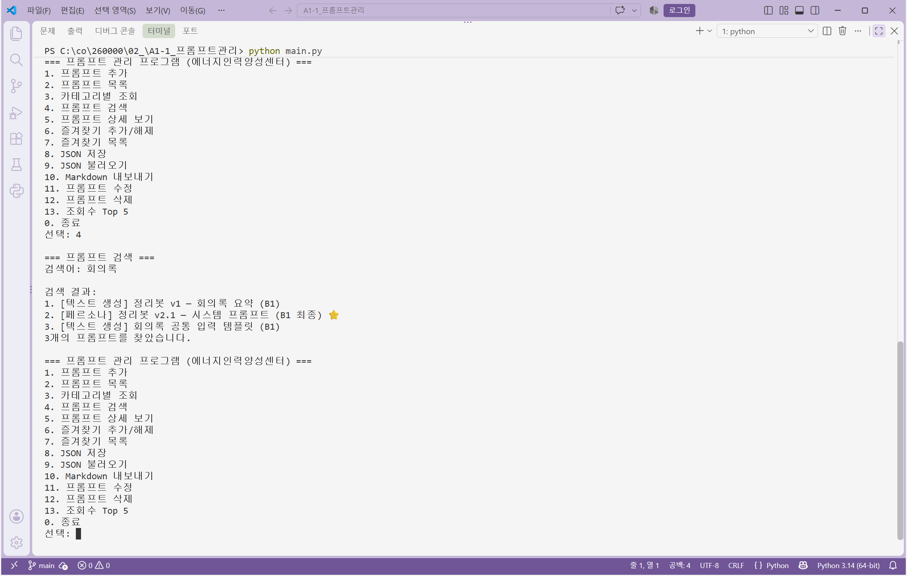

# 프롬프트 관리 프로그램

대학교 에너지인력양성센터에서 쓰는 LLM 프롬프트를 터미널 메뉴로 관리하는 Python 콘솔 프로그램입니다.
2단계 1-1 미션(Python · Git 기초) 과제로, 이전 미션(B1 회의록 정리봇, B3 문의 자동화)에서 작성한 프롬프트 5개가 기본 데이터로 등록되어 있습니다.

- 외부 라이브러리 없이 Python 표준 라이브러리(`json`, `os`)만 사용
- 프롬프트는 리스트 안의 딕셔너리(`title / content / category / favorite / views`)로 저장
- 기능별로 함수를 분리하고, 메뉴는 `MENU` 표 하나로 관리

## 실행 방법

Python 3.10 이상이 필요합니다(개발 환경: Python 3.14.7, Windows 11).

```
git clone https://github.com/etu9317cw/codyssey_a1_1.git
cd codyssey_a1_1
python main.py
```

Windows 터미널에서 ⭐ 같은 특수 문자가 깨지면 UTF-8 모드로 실행합니다.

```
python -X utf8 main.py
```

실행하면 `prompts.json`이 있을 때 자동으로 불러오고, 없으면 코드 안의 기본 프롬프트 5개로 시작합니다.

## 기능 목록

| 메뉴 | 기능 | 함수 | 설명 |
|---|---|---|---|
| 1 | 프롬프트 추가 | `add_prompt()` | 제목·내용·카테고리 입력. 빈 입력은 다시 요청. 카테고리는 번호 선택 또는 직접 입력. 즐겨찾기 기본값 False |
| 2 | 프롬프트 목록 | `show_list()` | `번호. [카테고리] 제목 ⭐` 형식으로 전체 출력. 비어 있으면 안내 |
| 3 | 카테고리별 조회 | `show_by_category()` | 카테고리를 고르면 그 카테고리만 출력. 없으면 안내 |
| 4 | 프롬프트 검색 | `search_prompt()` | 키워드가 제목 또는 내용에 포함된 프롬프트 검색(대소문자 무시) |
| 5 | 프롬프트 상세 보기 | `show_detail()` | 제목·카테고리·즐겨찾기·조회수·내용 전체 출력. 잘못된 번호 안내 |
| 6 | 즐겨찾기 추가/해제 | `toggle_favorite()` | 번호를 입력하면 ⭐ 토글 |
| 7 | 즐겨찾기 목록 | `show_favorites()` | ⭐ 표시된 프롬프트만 모아보기 |
| 8 | JSON 저장 (보너스 1) | `save_json()` | 전체 프롬프트를 `prompts.json`에 저장 |
| 9 | JSON 불러오기 (보너스 1) | `load_json()` | `prompts.json`을 읽어 목록 교체. 파일 없음·형식 오류 안내 |
| 10 | Markdown 내보내기 (보너스 1) | `export_markdown()` | `prompts_export/<카테고리>.md` 파일 생성 |
| 11 | 프롬프트 수정 (보너스 2) | `edit_prompt()` | 제목·내용·카테고리 수정. 비워 두면 기존 값 유지 |
| 12 | 프롬프트 삭제 (보너스 2) | `delete_prompt()` | y/n 확인 후 삭제 |
| 13 | 조회수 Top 5 (보너스 2) | `show_top()` | 상세 보기 횟수(`views`) 내림차순 상위 5개 |
| 0 | 종료 | — | 프로그램 종료 |

잘못된 메뉴 번호를 입력하면 안내 메시지 후 메뉴로 돌아옵니다. 모든 기능은 실행 후 메뉴로 복귀합니다.

## 카테고리

추가 시 번호로 고르거나 `7) 직접 입력`으로 새 카테고리를 만들 수 있습니다.

| 카테고리 | 용도 | 기본 프롬프트 |
|---|---|---|
| 텍스트 생성 | 요약·초안·템플릿 등 글을 만드는 프롬프트 | 정리봇 v1, 회의록 공통 입력 템플릿 |
| 이미지 생성 | 이미지 생성 모델용 프롬프트 | (없음) |
| 영상 생성 | 영상 생성 모델용 프롬프트 | (없음) |
| 페르소나 | 역할·말투·규칙을 정의한 시스템 프롬프트 | 정리봇 v2.1 시스템 프롬프트 |
| 자동화 | Make/Zapier 등 자동화 도구에 넣는 메일·메시지 템플릿 | 담당자 알림 메일, 학생 접수 확인 메일 |
| 기타 | 위에 속하지 않는 것 | (없음) |

## 기본 프롬프트 (이전 미션 출처)

| # | 제목 | 카테고리 | 출처 |
|---|---|---|---|
| 1 | 정리봇 v1 — 회의록 요약 | 텍스트 생성 | B1 LLM 회의록 요약 정리봇 (첫 버전) |
| 2 | 정리봇 v2.1 — 시스템 프롬프트 ⭐ | 페르소나 | B1 최종 시스템 프롬프트 (역할·목표·말투·출력 형식·규칙) |
| 3 | 회의록 공통 입력 템플릿 | 텍스트 생성 | B1 모델 비교에 쓴 공통 입력 틀 |
| 4 | 담당자 알림 메일 템플릿 — 문의 유형별 | 자동화 | B3 노코드 문의 자동화 (Make Router 경로별 메일) |
| 5 | 학생 접수 확인 메일 템플릿 ⭐ | 자동화 | B3 프로젝트 2 학생 자동 회신 메일 |

## 보너스 기능

- **보너스 1 영속화·내보내기**: 메뉴 8·9로 `prompts.json` 저장·불러오기, 시작 시 자동 불러오기. 메뉴 10으로 카테고리별 Markdown 파일 내보내기(`prompts_export/`).
- **보너스 2 CRUD·사용 기록**: 메뉴 11·12로 수정·삭제(삭제는 y/n 확인). 상세 보기(메뉴 5)마다 조회수 기록, 메뉴 13에서 조회수 Top 5.

## 폴더 구조

```
.
├── main.py              # 프로그램 전체 (데이터·헬퍼·기능 함수·메뉴)
├── images/              # 제출 스크린샷
├── .gitignore
└── README.md
```

실행 중에 만들어지는 파일:

- `prompts.json` — 메뉴 8(JSON 저장)로 생성, 다음 실행 때 자동으로 불러옴
- `prompts_export/<카테고리>.md` — 메뉴 10(Markdown 내보내기)으로 생성

## Git 작업 기록

- 기능 단위로 커밋(한국어 메시지), `feature/list` 브랜치에서 목록 기능을 만든 뒤 `main`에 `--no-ff`로 병합
- `git log --oneline --graph` 결과는 아래 "제출 스크린샷" 절 참고

## 제출 스크린샷

### 개발 환경 설정

VSCode 통합 터미널에서 Python·Git 버전 확인 (Python 3.14.7, Git 2.55.0)



Git 전역 설정 (`user.name`, `user.email`, 기본 브랜치 `main`, `core.autocrlf=false`, 이메일 앞 숫자는 가림)



### 프로그램 실행 결과

메뉴 (`python main.py`)



프롬프트 추가 — 빈 제목은 다시 입력 요청, 카테고리는 번호로 선택



프롬프트 목록 — 기본 5개 + 방금 추가한 1개, 즐겨찾기 ⭐ 표시



프롬프트 검색 — `회의록`이 제목 또는 내용에 들어간 프롬프트 3개


